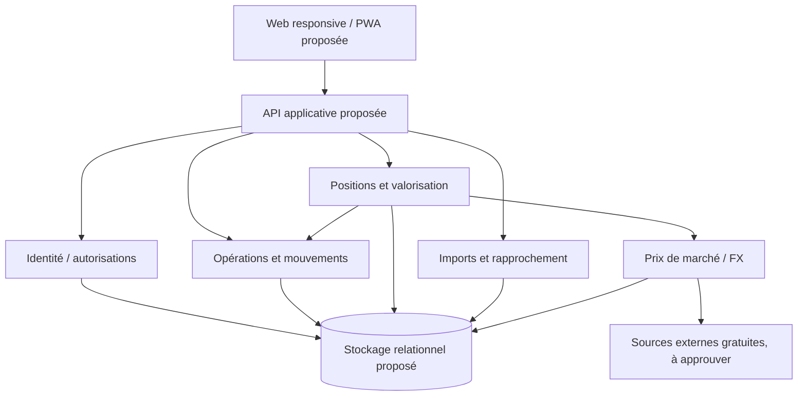

# Atlas Portfolio — Architecture technique cible

> **Version :** 0.1 — 2026-11-05  
> **Statut :** Architecture de référence **proposée**, non implémentée  
> **Source produit :** `PRD.md` v0.2 ; **décisions :** `ADR.md` ; **exécution :** `ROADMAP.md` v0.1 ; **UX :** `design.md`  
> **Important :** les choix liés aux ADR `proposed` ne sont pas une autorisation implicite de développement.

## 1. Mission et limites

Atlas Portfolio permet à plusieurs utilisateurs de suivre des portefeuilles logiques regroupant des comptes boursiers, crypto et d'épargne. Les positions, liquidités et performances proviennent d'opérations historiques ; les cours et taux de change proviennent de sources identifiables. Le produit doit fonctionner sur Linux avec Docker Compose, sans service payant indispensable, et offrir une UI web responsive.

**Hors MVP :** Research/IA, analyse fondamentale, trading automatisé, DeFi complexe, connecteurs bancaires non officiels, publication de flux boursiers sous licence incompatible, serveur de notifications complexe. L'interface admin avancée et la consultation hors ligne complète sont V1 selon le PRD.

## 2. Statut des choix techniques

| Choix | Statut | Traçabilité |
| --- | --- | --- |
| Docker Compose sur Linux, auto-hébergement, coût récurrent obligatoire nul | Confirmé côté produit | ADR-0001 `accepted` |
| Opérations sources de vérité, snapshots dérivés | Confirmé côté produit | ADR-0002 `accepted` |
| Comptes individuels et isolation financière | Confirmé côté produit | ADR-0003 `accepted` |
| Monolithe modulaire | Proposition | ADR-0004 `proposed` |
| React + TypeScript + Vite / Go / PostgreSQL | Proposition | ADR-0005 `proposed` |
| Mouvements exacts + contrôles d'intégrité | Proposition | ADR-0006 `proposed` |
| Fournisseurs de cours via adaptateurs | Proposition | ADR-0007 `proposed` |
| Sessions sécurisées locales et pipeline CSV | Proposition | ADR-0008/0009 `proposed` |

Le dépôt ne doit **pas** être décrit comme implémentant ce diagramme avant que du code réel n'existe. `CODEBASE_GRAPH.md` documentera l'implémentation vérifiée, non cette cible.

## 3. Vue logique



**Frontières :** le navigateur ne reçoit jamais de clés API fournisseur ; l'API valide les autorisations sur chaque ressource ; le moteur de calcul ne dépend pas du frontend ni du fournisseur de cours ; les intégrations restent périphériques au ledger.

## 4. Modules envisagés

| Domaine | Responsabilité | Exigences PRD |
| --- | --- | --- |
| `identity` | Inscription, connexion, session, rôles techniques, autorisations | F-001/002, US-009 |
| `portfolio` | Portefeuilles, comptes, associations, archivage | F-003/005 |
| `assets` | Instruments, identifiants ISIN/place/ticker/contrat, type, devise | F-006/007 |
| `ledger` | Opérations, mouvements, corrections, idempotence, audit | F-008/011 |
| `valuation` | Positions, cash, CMP, P&L, séries et consolidation | F-013/017 |
| `marketdata` | Recherche/cotations/FX, cache, fraîcheur et quotas | F-018/019 |
| `imports` | CSV pilotes, aperçu, dédoublonnage, validation, rapprochement | F-012 |
| `exports` | Export ouvert du patrimoine et de l'historique | F-020 |
| `operations` | Health checks, sauvegarde/restauration et télémétrie technique limitée | F-022 |

Un module n'est pas un microservice ni nécessairement un package unique. Les noms sont indicatifs ; ils doivent être vérifiés contre les choix de stack acceptés et les conventions réelles du dépôt.

## 5. Contrat métier — invariants

### 5.1 Entités conceptuelles

```text
User 1 ── N Portfolio 1 ── N Account
Account 1 ── N Transaction
Transaction 1 ── N Movement
Asset 1 ── N PriceObservation
CurrencyPair 1 ── N FXObservation
ImportBatch 1 ── N ImportRow
```

`User` possède la ressource privée ; `Portfolio` est un regroupement logique ; `Account` représente le lieu de détention ; `Asset` représente un instrument de façon non ambiguë, ticker seul insuffisant ; `Transaction` est une opération utilisateur/importée et `Movement` représente ses effets en unités, espèces et frais ; les observations de prix et de FX sont historisées avec source et horodatage.

Les opérations de transfert peuvent référencer deux comptes ; ne pas les réduire à deux opérations externes indépendantes. Les corrections portent une référence à l'opération d'origine, un auteur, une date et un motif. Les snapshots sont reconstructibles et **ne sont pas la source de vérité**.

### 5.2 Règles qui ne peuvent pas être improvisées

- **Q-02 :** soldes d'ouverture et historiques incomplets, politique d'acceptation d'un cash négatif — bloquant pour le ledger.
- **Q-03 :** coût économique des récompenses de staking — bloquant pour le calcul correspondant.
- **Q-04 :** swaps crypto dans un historique importé — ne pas les transformer arbitrairement en achats/ventes.
- **Q-07 :** intérêts et solde Livret A/PEL sans simulation de produits non acquis.

Avant de coder ces branches, définir des scénarios chiffrés attendus et l'invariant applicable.

### 5.3 Précision et coût de revient

- Utiliser des représentations décimales exactes pour les valeurs métier persistées (ex. `NUMERIC` et bibliothèque décimale dédiée si Go approuvé). Éviter `float32/float64` pour l'arithmétique financière.
- Préserver montant et devise originaux, frais, quantité et taux de conversion réellement observé ; ne pas arrondir au fil des calculs, seulement aux frontières de présentation/settlement selon des règles approuvées.
- Le PRD propose le **coût moyen pondéré économique**, avec acquisition frais inclus et retrait proportionnel du coût restant lors d'une vente. Cela **n'est pas un calcul fiscal**.
- Les positions et résultats doivent être recalculables à une date donnée. Une vente partielle, un transfert et une opération antidatée ne doivent pas corrompre les coûts restants.
- Séparer : évolution du **cours du marché**, résultat **latent/réalisé** de la position, variation de **valeur** du portefeuille, et **rendement** tenant compte des flux externes.
- Ne pas produire un pourcentage de performance global lorsque les données d'origine sont insuffisantes pour le calcul défini.

### 5.4 Consolidation

`PortfolioValue(t)` = somme des valorisations des positions détenues à `t` + soldes cash à `t` + soldes des comptes d'épargne à `t`, après conversion FX datée lorsque nécessaire.

Un dépôt externe modifie les flux d'apport, pas le gain économique. Un achat transforme cash en actif, sans doubler les apports. Un transfert interne déplace une détention sans créer ni performance ni nouvel apport global. Les frais et revenus sont appliqués une fois, avec leur source.

## 6. API — contrats indicatifs, non encore figés

Les ressources API ne doivent être créées que dans des lots approuvés. Convention **proposée** : API REST versionnée `/api/v1`, ressources privées et IDs opaques.

| Ressource candidate | But | Conditions |
| --- | --- | --- |
| `POST /api/v1/auth/login` | Session | anti-bruteforce, cookies sécurisés |
| `GET /api/v1/portfolios` | Portefeuilles du propriétaire | contrôle d'identité |
| `POST /api/v1/portfolios` | Créer un portefeuille | validation et ownership |
| `GET /api/v1/portfolios/{id}/summary` | Synthèse chiffrée | dates/fraîcheur/provenance |
| `GET /api/v1/portfolios/{id}/positions` | Positions calculées | valeurs éventuellement partielles |
| `GET /api/v1/portfolios/{id}/history` | Séries datées | couverture, FX, trous explicites |
| `POST /api/v1/transactions` | Opération atomique | idempotence et règles métier |
| `GET /api/v1/transactions` | Historique filtré | accès propriétaire |
| `GET /api/v1/assets/search` | Recherche d'actifs | identifiants non ambigus |
| `POST /api/v1/import-batches` | Créer un lot en prévisualisation | aucune écriture métier prématurée |
| `POST /api/v1/import-batches/{id}/confirm` | Appliquer un import vérifié | atomicité, dédoublonnage |
| `GET /api/v1/exports` | Export documenté | droits et confidentialité |

Les structures exactes, codes d'erreur, pagination, dates et précision doivent être établis dans un contrat OpenAPI pendant la phase adéquate. Toutes les écritures critiques répondent seulement après confirmation serveur. Pas de faux succès frontend.

## 7. Flux structurants

### 7.1 Achat manuel

1. L'utilisateur choisit un compte et un actif, une date, un montant total ou une quantité, prix et frais.
2. Le frontend calcule un aperçu indicatif ; le serveur recalcule et valide la devise, la précision, les droits et la cohérence métier.
3. Une transaction applicative unique écrit l'événement, ses mouvements et sa clé d'idempotence ; elle échoue en totalité si un invariant est violé.
4. Les projections affectées sont recalculées ou invalidées puis reconstruites.
5. L'UI affiche une confirmation **uniquement après acquittement**, puis le résultat réellement recalculé.

### 7.2 Consultation du dashboard

1. Autoriser l'utilisateur et déterminer les comptes visibles.
2. Charger positions, cash et comptes d'épargne à la date choisie.
3. Résoudre les cours et taux disponibles **avec leur date**, calculer les valeurs, signaler la couverture partielle.
4. Retourner valeur consolidée, P&L, flux externes et séries historiques avec métadonnées de qualité.
5. Rendre les dix principaux actifs, meilleures/pires performances et répartitions sans inventer de cours manquants.

### 7.3 Import CSV

1. Détecter le format **explicitement supporté** ; stocker le lot et son empreinte sans appliquer d'opération.
2. Parser et normaliser ; afficher la prévisualisation, les anomalies et les doublons potentiels.
3. L'utilisateur résout les ambiguïtés et confirme.
4. Appliquer les opérations validées de manière idempotente, avec audit et rapport final.
5. Un réimport du même fichier ne crée pas de second ensemble d'opérations.

## 8. Prix, FX et fraîcheur

L'adaptateur de données est proposé, aucun fournisseur n'est validé à ce stade. Un prix ou taux doit inclure `instrument`, `value`, `currency`, `observed_at`, `provider`, `kind` (`realtime`, `delayed`, `end_of_day` ou autre statut confirmé), et `quality_status`.

- Mettre en cache les réponses selon limites contractuelles, utiliser des appels groupés si disponibles et limiter les retries.
- Refuser de diffuser une donnée lorsque sa licence ne le permet pas.
- Pour les titres, l'accès temps réel gratuit n'est **pas garanti**. Une période de rafraîchissement fréquente ne prouve pas que le prix est en temps réel.
- Distinguer `market_closed` **confirmé** d'un fournisseur simplement indisponible.
- Valeur absente : état explicite, jamais `0` substitué silencieusement. Dernier cours connu : daté, marqué comme ancien si approprié.
- Les observations historiques et taux FX sont utilisés pour les historiques — les positions actuelles ne sont pas réappliquées au passé.

**Décisions bloquantes :** Q-05 actifs pilotes et Q-06 fournisseurs/licences.

## 9. Sécurité et vie privée

- Authentification individuelle (MVP) et vérification côté serveur pour chaque portefeuille, compte, opération, import et export.
- Rôles administratifs techniques distincts du droit de lire les investissements privés.
- Sessions sécurisées ; protections contre CSRF et attaques de force brute adaptées à l'implémentation retenue.
- Secrets jamais stockés dans Git, dans les bundles frontend ni en clair dans les logs.
- Données de test **fictives et explicitement identifiées**, jamais injectées dans une session réelle comme données de portefeuille.
- Imports considérés comme fichiers non fiables : limite de taille, contrôle du type, parsing sûr et nettoyage après traitement.
- Sauvegardes chiffrées, restauration testée ; le chiffrement disque protège le stockage au repos mais ne se substitue pas aux contrôles applicatifs.
- Protection d'accès distant par HTTPS et politique de mise à jour ; aucune exposition administrative publique non nécessaire.
- Exports privés, avec mesures contre la fuite via URLs prévisibles, caches partagés et logs.

## 10. Déploiement et exploitation

**Cible confirmée :** Linux sur mini-PC, Docker Compose ; disponibilité distant via smartphone. **Configuration de services proposée :** frontend servi statiquement, API applicative, PostgreSQL, reverse proxy TLS. Aucun service de queue, cache externe ou moteur IA requis dans le MVP.

```text
[Browser desktop/mobile] -- HTTPS --> [Reverse proxy]
                                        |-- Static UI
                                        `-- API --> [Database]
                                                 --> [Market providers]
```

- Volumes persistants documentés ; migrations versionnées avec rollback/reprise définis selon la nature du changement.
- `.env.example` sans secret ; ports internes non publiés inutilement ; containers non root si possible ; images verrouillées à versions maintenues.
- Sauvegarde quotidienne de la base et des éléments de configuration nécessaires ; chiffrement et vérification de restauration.
- Health checks et logs structurés sans contenu financier ; diagnostics de quotas, pannes fournisseurs et échec d'import.
- Mode hors ligne : cache des dernières données datées au minimum ; **PWA offline complet = V1** sans inventer de synchronisation de saisie hors ligne pour le MVP.

## 11. Qualité et stratégie de tests

**Niveaux :** unités métier pures (aucun réseau), intégration base/API, contrats des adaptateurs, E2E UI, tests de permissions, CI de sécurité.

| Test | Garantie visée |
| --- | --- |
| Plusieurs achats et vente partielle | CMP, coût restant, gain réalisé |
| Frais et dividende | Aucun double comptage |
| Dépôt suivi d'un achat | Apports distincts de performance |
| Transfert de comptes | Conservation de la valeur consolidée |
| Opération antidatée ou corrigée | Projections reconstruites sans perte de traçabilité |
| Achat USD, affichage EUR | FX historique correct, taux connu |
| Cours absent/ancien | État de qualité explicite, pas de faux zéro |
| Staking simple | Quantité et coût conformes à Q-03 après décision |
| Historique incomplet | Incertitude visible, pas de P&L mensonger |
| Import CSV répété | Aucun doublon, rapport explicite |
| Utilisateurs A et B | Aucune lecture ou écriture cross-user |
| Backup et restore | Données et droits récupérables |

Les jeux de tests chiffrés T-01 à T-12 du `PRD.md` servent de référence. Codex ne prétend pas les avoir passés sans exécution.

## 12. Plan d'implémentation (non autorisation automatique)

| Phase de `ROADMAP.md` | Architecture attendue |
| --- | --- |
| 0 | ADR approuvés, contrats métier (Q-02/Q-03), choix des actifs pilotes, diagrammes vérifiés |
| 1 | Identité, comptes, portefeuilles, opérations, sécurité et migrations |
| 2 | Positions, valorisation, prix/FX, historique et pannes contrôlées |
| 3 | Interfaces prévues par `design.md` et parcours E2E |
| 4 | Imports CSV, rapprochements, correction, audit |
| 5 | Exports, sauvegardes, CI, Docker et publication reproductible |
| 6 | DCA, objectifs, benchmarks, personnalisation, offline V1 et admin |
| 7 | Research/IA séparés, sous nouveaux contrats et ADR |

## 13. Questions en attente et condition de démarrage

**Avant le scaffolding de l'application :** confirmer ADR-0004 et ADR-0005 ; ne pas présenter le dossier envisagé comme une arborescence existante.

**Avant le ledger et la valorisation :** Q-02 et Q-03 + règles de précision et fixtures validées (ADR-0006).

**Avant les intégrations de marché :** Q-05 et Q-06 + démonstration de couverture et droit d'utilisation (ADR-0007).

**Avant les imports :** Q-01 et traitement Q-04 (ADR-0009).

**Avant les écrans correspondants :** Q-07/08/09 selon le domaine.

Le premier prompt Codex recommandé est un **audit C-00 sans implémentation métier** : vérifier l'état du dépôt, les documents et les décisions ouvertes, proposer une séquence de travaux et des scénarios de test, puis solliciter les approbations réellement bloquantes.

**Cette architecture est une cible à valider, pas une description de services déjà développés.**
